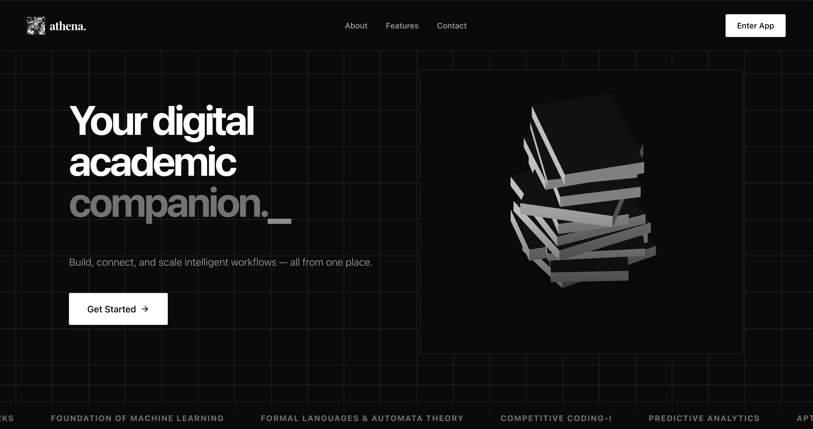
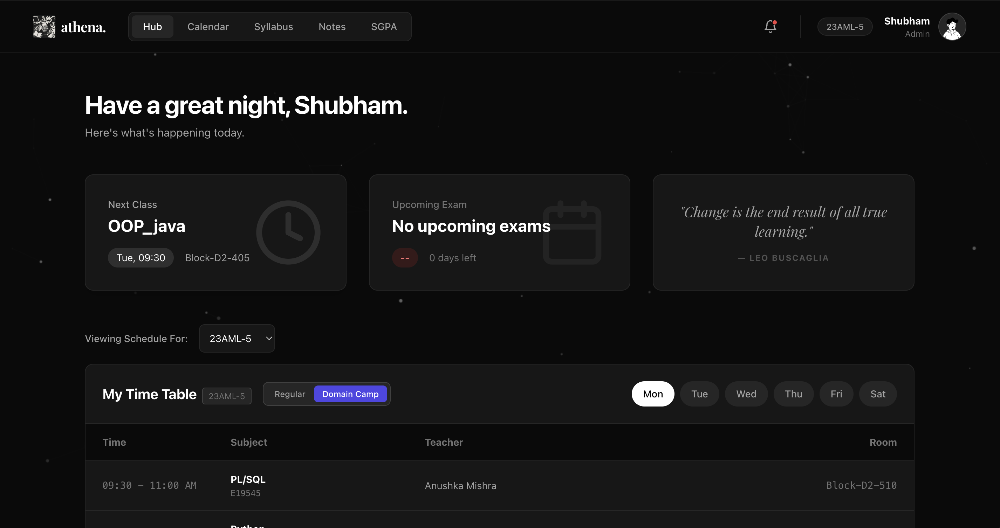
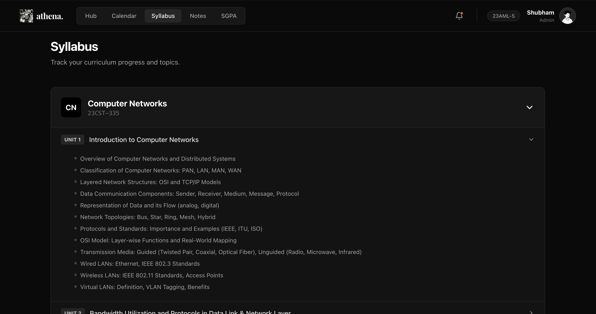
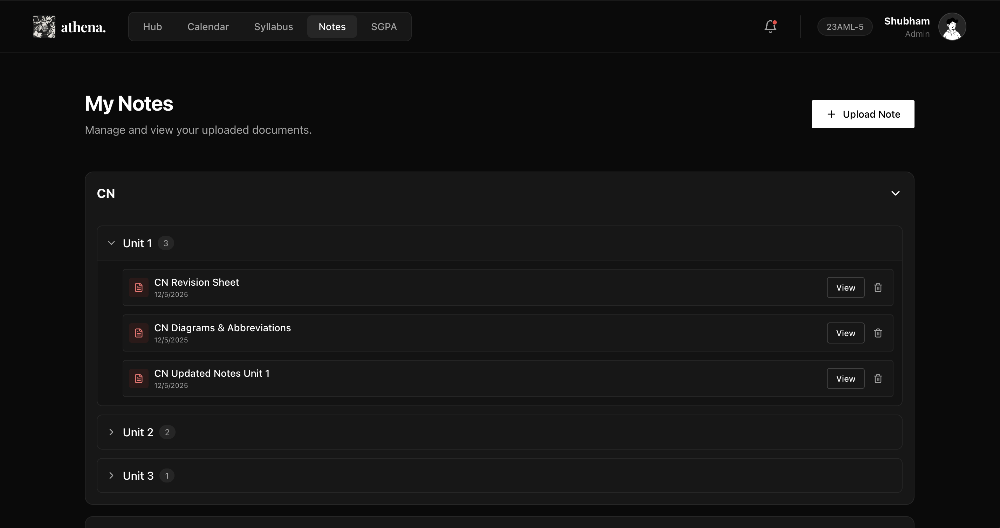
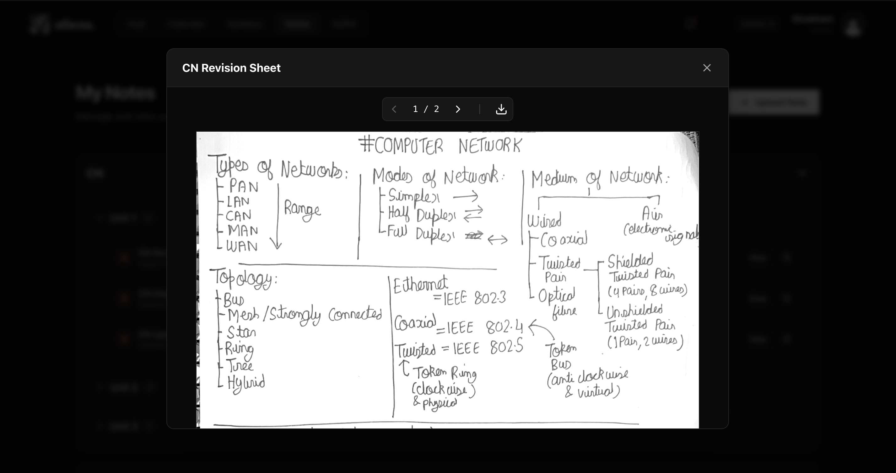

# athena.

<div align="center">
  
  <br /><br />
  <h1>Your Digital Academic Companion</h1>
  <p>
    <strong>Build, connect, and scale intelligent academic workflows — all from a single, unified interface.</strong>
  </p>
  <p>
    <a href="https://react.dev/">
      
    </a>
    <a href="https://vitejs.dev/">
      
    </a>
    <a href="https://tailwindcss.com/">
      
    </a>
    <a href="https://firebase.google.com/">
      
    </a>
    <a href="https://cloudinary.com/">
      
    </a>
    <a href="https://greensock.com/gsap/">
      
    </a>
    <a href="https://lenis.darkroom.engineering/">
      
    </a>
    <a href="https://threejs.org/">
      
    </a>
  </p>
</div>

---

## 📑 Table of Contents

- [Overview & The Philosophy](#-overview--the-philosophy)
- [Architecture & Migration (Supabase to Firebase + Cloudinary)](#-architecture--migration-supabase-to-firebase--cloudinary)
- [Key Features](#-key-features)
  - [🏠 Unified Student Hub](#-unified-student-hub)
  - [📝 Notes Hub & Cloudinary Asset Engine](#-notes-hub--cloudinary-asset-engine)
  - [📄 Non-Blocking Interactive PDF Viewer](#-non-blocking-interactive-pdf-viewer)
  - [📅 Academic Timetable & Schedule Timeline](#-academic-timetable--schedule-timeline)
  - [📚 Syllabus Progress Tracker](#-syllabus-progress-tracker)
  - [📊 Interactive SGPA Calculator](#-interactive-sgpa-calculator)
  - [🛡️ Live Feedback & Diagnostic Reporting System](#️-live-feedback--diagnostic-reporting-system)
  - [🔔 Real-Time Broadcast Notification Center](#-real-time-broadcast-notification-center)
  - [🧭 Resilient Onboarding Tour](#-resilient-onboarding-tour)
  - [🎭 Multi-Avatar Profile Customization](#-multi-avatar-profile-customization)
- [Motion, 3D & Animation Engineering](#-motion-3d--animation-engineering)
  - [GSAP Micro-Sequencing](#gsap-micro-sequencing)
  - [Lenis Smooth Scrolling & Hijack Prevention](#lenis-smooth-scrolling--hijack-prevention)
  - [Three.js & Dither Shader Statue](#threejs--dither-shader-statue)
  - [Hardware-Accelerated Marquee Tickers](#hardware-accelerated-marquee-tickers)
  - [Dynamic Spotlight Cards & Typography](#dynamic-spotlight-cards--typography)
- [Visual Showcase](#-visual-showcase)
- [Tech Stack](#-tech-stack)
- [Database Schema (Firestore)](#-database-schema-firestore)
- [Project Directory Structure](#-project-directory-structure)
- [Getting Started](#-getting-started)
- [License & Author](#-license--author)

---

## 📖 Overview & The Philosophy

> *"I named this project Athena after the Greek goddess of wisdom, since I have always been fascinated by Greek mythology ever since I read the Percy Jackson series in 6th grade. I want Athena to be just that: a personification of wisdom, an ultra-premium digital companion for your academic needs."*

**Athena** is an all-in-one academic command center and workflow accelerator built for students and researchers. Academic life often gets scattered across disparate tools—PDF viewers, chaotic Google Drive links, calendar spreadsheets, scattered syllabus PDFs, and mental Grade Point math. Athena eliminates this friction by unifying everything under a single, dark-mode-first editorial interface built with motion physics, real-time database synchronization, and scalable cloud storage.

---

## 🔄 Architecture & Migration (Supabase to Firebase + Cloudinary)

Athena previously leveraged Supabase for authentication, PostgreSQL relational storage, and storage buckets. As the platform scaled and evolved into a production-ready application with heavy multimedia demands and high-concurrency real-time broadcasts, the architecture underwent a full migration:

### 1. Cloud Firestore & Firebase Auth (Replacing PostgreSQL & Supabase Auth)
- **Zero Cold-Starts & Instant Sync**: Migrated from relational tables to Google Cloud Firestore collections (`profiles`, `notes`, `notifications`, `feedback`, `system_stats`).
- **Flexible Document Models**: Real-time snapshot listening for notifications and incoming feedback reports without complex websocket connection management.
- **Hybrid Role-Based Access**: Multi-tier authentication supporting authenticated Administrators, regular Students, and instant-access Guest accounts with persisted local state and optimistic profile updates.

### 2. Cloudinary High-Performance CDN (Replacing Supabase Storage)
- **High-Throughput Direct Uploads**: Note uploads now bypass intermediate server proxies by streaming directly via Cloudinary's unsigned upload API.
- **Dynamic Organization**: Files are programmatically filed into structured folders by academic subject and unit (e.g. `notes/CV/Unit 1`, `notes/NLP/Unit 3`).
- **Edge Delivery**: Lightning-fast global CDN caching for multi-megabyte lecture slides and PDF notes, drastically reducing load times in the embedded PDF reader.

---

## ✨ Key Features

### 🏠 Unified Student Hub
- **Command Center Layout**: Carefully calibrated to fit single-screen viewports without unnecessary scrolling.
- **Dynamic Time-Aware Greetings**: Personalized greeting cards displaying the active user's first name, role badge, and current academic standing.
- **Upcoming Exam Countdown**: Live computation of days remaining until impending midterms and finals (e.g. *MST-2: Principles of Human Communication*).
- **Curated Wisdom**: Daily rotated motivational quotations from celebrated thinkers and philosophers.
- **Course Credits Overview**: Instant visual reference for semester subjects, course codes (`23CSH-437`, `23CSH-438`, `23CST-432`, `JMO-354`), and unit credit weights.
- **Quick Action Gateways**: Direct one-click access into Notes and Syllabus prep modules.

### 📝 Notes Hub & Cloudinary Asset Engine
- **Multi-Subject Filtering**: Dedicated tabs for core curriculum subjects:
  - *Computer Vision (CV)*
  - *Natural Language Processing (NLP)*
  - *Research Methodology (RM)*
  - *Principles of Human Communication (PHC)*
- **Unit Segmentation**: Organized into Unit 1, Unit 2, Unit 3, Unit 4, and General references.
- **Hybrid Uploads**: Supports both direct PDF file uploads (via Cloudinary CDN) and external reference URLs (arXiv papers, GitHub repositories, lecture slides).
- **Embedded Document Launcher**: Click any document card to immediately launch Athena’s built-in reader.

### 📄 Non-Blocking Interactive PDF Viewer
- **Built on `react-pdf` & `pdfjs-dist`**: Native PDF rendering directly inside the web interface without third-party iframe quirks.
- **Interactive Controls**: Multi-level zoom (Zoom In, Zoom Out, Reset Fit), page-by-page stepping, direct page jump input, and full-screen document presentation.
- **Lenis Isolation (`data-lenis-prevent`)**: Specially configured scroll boundary isolation ensuring mouse wheel and trackpad gestures scroll the PDF document cleanly without accidentally scrolling the background page.
- **Themed Sleek Scrollbars**: Custom minimalist scrollbar aesthetic matching Athena's dark editorial theme.

### 📅 Academic Timetable & Schedule Timeline
- **Visual Timetable**: Week-at-a-glance layout detailing lecture timings, laboratory sections, room numbers, and instructor allocations.
- **Event Feed (`events.js`)**: Real-time chronological timeline tracking academic deadlines, guest lectures, assignment submissions, and exam windows.

### 📚 Syllabus Progress Tracker
- **Curriculum Architecture**: Unit-by-unit syllabus breakdowns for all semester subjects.
- **Topic Coverage**: Granular lecture sub-topics, required textbook references, course objectives, and grading distribution metrics.

### 📊 Interactive SGPA Calculator
- **Projected Performance Modeling**: Clean modal dialog accessible right from the navigation bar.
- **Grade & Credit Weighting**: Calculate Semester Grade Point Average (SGPA) dynamically by selecting anticipated letter grades across semester courses.
- **Real-Time Projection**: Instant recalculated grade points to help students plan target scores for honors qualifications.

### 🛡️ Live Feedback & Diagnostic Reporting System
- **Role-Aware Adaptive Interface (`FeedbackModal.jsx`)**:
  - **For Guests & Students**: A sleek diagnostics form allowing users to submit bug reports, suggestions, or praise directly to the engineering team.
  - **For Administrators**: Automatically transforms into a live **Incoming Diagnostics Inbox** (`max-w-2xl`), pulling reports straight from Firestore with real-time timestamps, author identity, categorized badges (`Bug` 🐛, `Suggestion` 💡, `Praise` 💖), and single-click report dismissal/deletion.

### 🔔 Real-Time Broadcast Notification Center
- **Notification Dropdown Tray**: Polished notification drawer with pulse indicators for unread alerts.
- **Admin Broadcast Composer**: Allows authenticated administrators to publish urgent campus notifications (announcements, syllabus corrections, schedule shifts) with custom alert styles (`info`, `warning`, `urgent`) visible to all active users instantly.

### 🧭 Resilient Onboarding Tour
- **Interactive Tour Engine (`OnboardingTour.jsx`)**: Step-by-step guided spotlight tour introducing new students and guests to key navigational elements.
- **SSR-Safe Storage Utility (`storage.js`)**: Robust localStorage wrappers preventing stale React closures, infinite re-trigger glitches, and storage quota exceptions.
- **Replay On Demand**: Instant one-click tour replay via the dedicated `HelpCircle` icon in the navigation bar.

### 🎭 Multi-Avatar Profile Customization
- **Vector Avatar Library**: Six distinct curated avatar seeds (*Felix, Aneka, Christian, Jocelyn, Alex, Aria*).
- **Persistent Profile Syncing**: Real-time profile state updates saved to Firestore for registered users and safely cached in local storage for guest sessions.

---

## 🎨 Motion, 3D & Animation Engineering

Athena is crafted with heavy emphasis on digital craftsmanship, fluid physics, and editorial polish:

### GSAP Micro-Sequencing
- **Entrance Choreography**: Powered by GreenSock (`gsap` and `@gsap/react`). Elements use `gsap.from()` with precise timing offsets (`delay: 1.8s` to `2.2s`) to ensure the initial landing screen animation fires only after assets and 3D scenes are completely mounted.
- **Staggered Reveals**: Cascading element reveals on hero typography, badges, and modal window backdrops (`ease: "power3.out"` and `"back.out(1.2)"`).

### Lenis Smooth Scrolling & Hijack Prevention
- **Inertial Momentum**: Global smooth scrolling configured via `lenis` across desktop and mobile browsers for tactile, weighted movement.
- **Scroll Hijacking Protection**: Custom `data-lenis-prevent="true"` boundaries integrated on modals, dropdown menus, and the PDF reading canvas to eliminate background bleeding and trackpad conflicts.

### Three.js & Dither Shader Statue
- **Interactive Dither Hero (`DitherHero.jsx`)**: Utilizes `@paper-design/shaders-react` and Three.js canvas shaders to render an ethereal, retro-dithered classical statue honoring Athena.
- **Constellation Particle Field (`ConstellationBackground.jsx`)**: Real-time canvas particle background simulating celestial connections and interconnected nodes.

### Hardware-Accelerated Marquee Tickers
- **Hero Subject Ticker (`MarqueeStrip.jsx`)**: Pure GPU compositor-driven CSS marquee cycling through core subjects (`RESEARCH METHODOLOGY`, `PRINCIPLES OF HUMAN COMMUNICATION`, `NATURAL LANGUAGE PROCESSING`, `COMPUTER VISION`).
- **Mathematical Seamlessness**: Built with `translateX(calc(-100% - var(--gap)))` on duplicated tracks. Operates at a brisk `--duration: 14s` with zero frame drops, zero tab-switching hitches, and zero abrupt resets.
- **Features Marquee (`Features.jsx`)**: Triple-track forward and reverse scrolling tracks with gradient edge masks.

### Dynamic Spotlight Cards & Typography
- **Spotlight Cards (`SpotlightCard`)**: Mouse-tracking radial gradient borders that subtly illuminate card edges based on cursor coordinates.
- **Random Letter Swap (`random-letter-swap.jsx`)**: Cybernetic cryptographic text decoding effects on headers and titles.

---

## 📸 Visual Showcase

### The Landing Page
<div align="center"> 
  
  <p><em>Cinematic landing interface featuring the interactive 3D dither statue, live visitor telemetry, and smooth subject tickers.</em></p>
</div>

### Student Command Hub
<div align="center">
  
  <p><em>Personalized command center: Next class reminders, exam countdowns, course credits, and daily schedule.</em></p>
</div>

### Syllabus Tracking
<div align="center">
  
  <p><em>Structured curriculum breakdown tracking topics, units, and credit distributions.</em></p>
</div>

### Notes Repository
<div align="center">
  
  <p><em>Cloudinary-powered asset repository for lecture slides, study guides, and academic papers.</em></p>
</div>

### Interactive PDF Viewer
<div align="center">
  
  <p><em>Embedded reader with isolated trackpad scrolling, responsive scaling, and page navigation controls.</em></p>
</div>

---

## 🛠 Tech Stack

| Domain | Technologies & Libraries |
| :--- | :--- |
| **Frontend Framework** | [React 18](https://react.dev/) with [Vite 5](https://vitejs.dev/) |
| **Routing** | [React Router DOM v6](https://reactrouter.com/) |
| **Styling & Design System** | [Tailwind CSS 3](https://tailwindcss.com/), PostCSS, Autoprefixer |
| **Motion & Animation** | [GSAP 3](https://greensock.com/gsap/), [@gsap/react](https://www.npmjs.com/package/@gsap/react), [Framer Motion](https://www.framer.com/motion/) |
| **Smooth Scrolling** | [Lenis 1.3](https://lenis.darkroom.engineering/) |
| **3D & Shaders** | [Three.js](https://threejs.org/), [@react-three/fiber](https://docs.pmnd.rs/react-three-fiber/), [@react-three/drei](https://github.com/pmndrs/drei), [@paper-design/shaders-react](https://www.npmjs.com/package/@paper-design/shaders-react) |
| **PDF Engine** | [React-PDF 9](https://github.com/wojtekmaj/react-pdf), [pdfjs-dist](https://www.npmjs.com/package/pdfjs-dist) |
| **Backend as a Service (BaaS)** | [Google Cloud Firebase 12](https://firebase.google.com/) (Authentication & Cloud Firestore) |
| **Media & Asset CDN** | [Cloudinary](https://cloudinary.com/) (Direct Unsigned Multipart Upload API) |
| **Iconography** | [Lucide React](https://lucide.dev/) |
| **Deployment & Hosting** | [Vercel](https://vercel.com/) |

---

## 🗄 Database Schema (Firestore)

Athena's real-time document structure in Cloud Firestore:

```typescript
// Collection: profiles
interface Profile {
  id: string;             // Firebase Auth UID
  first_name: string;     // e.g. "Shubham"
  last_name?: string;     // e.g. "Upadhyay"
  role: 'admin' | 'student' | 'guest';
  avatar_seed: string;    // e.g. "Felix", "Aneka", "Christian"
  semester?: string;
  created_at?: Timestamp;
}

// Collection: notes
interface Note {
  id: string;             // Auto-generated doc ID
  title: string;          // e.g. "CV Unit 1 Lecture Notes"
  subject: 'CV' | 'NLP' | 'RM' | 'PHC';
  unit: 'Unit 1' | 'Unit 2' | 'Unit 3' | 'Unit 4' | 'General';
  file_url: string;       // Cloudinary Secure CDN URL or external link
  file_path?: string;     // Cloudinary Public ID
  created_at: number;     // Epoch timestamp
}

// Collection: notifications
interface Notification {
  id: string;
  title: string;
  message: string;
  type: 'info' | 'warning' | 'urgent';
  created_at: string;     // ISO timestamp string
}

// Collection: feedback
interface FeedbackReport {
  id: string;
  type: 'bug' | 'suggestion' | 'praise';
  message: string;
  user_id: string;
  user_name: string;
  user_role: string;
  status: 'new' | 'reviewed' | 'resolved';
  created_at: Timestamp;
}

// Collection: system_stats
interface SystemStats {
  landing_views: number;  // Atomically incremented on visit
}
```

---

## 📁 Project Directory Structure

```text
athena/
├── public/                 # Static assets & favicon
│   ├── ava_encoded.svg
│   └── ...
├── src/
│   ├── components/         # Reusable presentation & feature components
│   │   ├── ui/             # Micro-UI primitives (Badges, Marquees, Loaders)
│   │   │   ├── Badge.jsx
│   │   │   ├── Marquee.jsx
│   │   │   ├── accordion-loader.jsx
│   │   │   └── random-letter-swap.jsx
│   │   ├── Avatar.jsx                  # Custom SVG avatar generator
│   │   ├── ConstellationBackground.jsx # Three.js canvas starfield
│   │   ├── DitherHero.jsx              # Three.js dither shader statue
│   │   ├── ErrorBoundary.jsx           # Global React error trap
│   │   ├── Features.jsx                # Multi-tier animated feature grid
│   │   ├── FeedbackModal.jsx           # Diagnostic report & Admin inbox
│   │   ├── Footer1.jsx                 # Editorial site footer
│   │   ├── HubNavbar.jsx               # Hub navigation, notifications & tour
│   │   ├── LoadingScreen.jsx           # Initial entry loading curtain
│   │   ├── MarqueeStrip.jsx            # Hardware-accelerated subject ticker
│   │   ├── OnboardingTour.jsx          # Interactive guided feature tour
│   │   ├── PdfViewer.jsx               # Isolated trackpad PDF canvas reader
│   │   └── SGPACalculator.jsx          # Projected SGPA calculation modal
│   ├── context/
│   │   └── AuthContext.jsx # Hybrid Firebase Auth & Guest session state
│   ├── data/
│   │   └── events.js       # Academic timetable & chronological schedule
│   ├── lib/
│   │   └── firebase.js     # Firebase App, Auth, Firestore & Storage client
│   ├── pages/
│   │   ├── Calendar.jsx    # Weekly timetable & calendar schedule
│   │   ├── Hub.jsx         # Command dashboard & overview
│   │   ├── Landing.jsx     # Cinematic hero landing page
│   │   ├── Login.jsx       # Student & Admin authentication
│   │   ├── NotFound.jsx    # 404 destination
│   │   ├── Notes.jsx       # Notes catalog & Cloudinary upload pipeline
│   │   └── Syllabus.jsx    # Unit-wise curriculum breakdown
│   ├── utils/
│   │   └── storage.js      # Resilient localStorage utility with fallback
│   ├── global.css          # Lenis smooth scroll & custom scrollbar rules
│   ├── index.css           # Tailwind base styles
│   └── main.jsx            # Application entry & Lenis initialization
├── .env.example            # Environment variables blueprint
├── tailwind.config.cjs     # Custom typography, animations & keyframes
├── vite.config.js          # Vite build & bundle optimizations
└── package.json            # Dependencies & build scripts
```

---

## 🚀 Getting Started

Follow these steps to run Athena locally on your machine.

### Prerequisites
- [Node.js](https://nodejs.org/) (version `18.x` or higher recommended)
- A [Firebase Project](https://console.firebase.google.com/) with **Authentication** and **Cloud Firestore** enabled.
- A free [Cloudinary Account](https://cloudinary.com/) with an unsigned upload preset configured.

### 1. Clone the Repository
```bash
git clone https://github.com/Shubham126710/athena..git
cd athena.
```

### 2. Install Dependencies
```bash
npm install
```

### 3. Configure Environment Variables
Copy `.env.example` into a new `.env` file in the project root:
```bash
cp .env.example .env
```

Fill in your Firebase and Cloudinary credentials:
```env
# Firebase Configuration
VITE_FIREBASE_API_KEY="your-api-key"
VITE_FIREBASE_AUTH_DOMAIN="your-project-id.firebaseapp.com"
VITE_FIREBASE_PROJECT_ID="your-project-id"
VITE_FIREBASE_STORAGE_BUCKET="your-project-id.appspot.com"
VITE_FIREBASE_MESSAGING_SENDER_ID="your-sender-id"
VITE_FIREBASE_APP_ID="your-app-id"

# Cloudinary Storage Configuration
VITE_CLOUDINARY_CLOUD_NAME="your-cloudinary-cloud-name"
VITE_CLOUDINARY_UPLOAD_PRESET="your-unsigned-upload-preset"
```

> [!TIP]
> In Cloudinary, create an **Unsigned Upload Preset** under *Settings > Upload > Upload presets* to allow secure direct note uploads from the browser.

### 4. Run the Development Server
```bash
npm run dev
```
Navigate to `http://localhost:5173` to explore the application locally.

### 5. Build for Production
```bash
npm run build
```
The optimized production bundle will be generated in the `dist/` directory, ready for deployment to Vercel or any modern static hosting provider.

---

## 🤝 Contributing

Contributions, bug reports, and suggestions are always welcome!
1. Fork the Project
2. Create your Feature Branch (`git checkout -b feature/EpicFeature`)
3. Commit your Changes (`git commit -m 'feat: Add an epic feature'`)
4. Push to the Branch (`git push origin feature/EpicFeature`)
5. Open a Pull Request

---

## 📄 License & Author

Distributed under the **MIT License**.

Built with precision and passion by **[Shubham Upadhyay](https://github.com/Shubham126710)**.

<div align="center">
  <sub>Athena — The Personification of Wisdom for Your Academic Journey.</sub>
</div>
